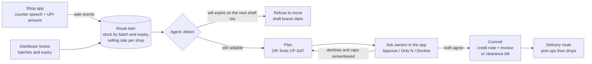

# Stockbridge

**An agent that moves stock between kirana shops before it expires.**

Homingo Hack Days, Agents track · Team Terra, Thapar Institute, Patiala

---

## The problem

**What changed.** India's kirana shops now take most payments by UPI, and every shop on a distributor's
route is visited by the same salesman every week. The sale data and the delivery van are already there.

**What's broken.** Stock still gets stranded. One shop sits on 9 jars of Horlicks it will never sell,
while a shop 1 km away on the same route runs out. Nobody sees both shelves at once, so the jars expire
and get written off. Shop owners don't keep sale-by-sale records, so the distributor can't see this coming either.

**What we want.** A system that:
1. records what each shop sells, with no typing;
2. spots, weeks ahead, which batches won't sell before they expire;
3. works out which nearby shop can sell them in time;
4. asks both owners in one tap;
5. does the paperwork and puts the move on the next delivery run;
6. learns from every "no".

## What the agent does



**1. Capture (shop app).**
- An old phone at the counter hears the order ("bhaiya teen Parle-G ek Surf dena"). The UPI amount arrives at the same moment.
- An LLM (Llama 3.3 70B on NVIDIA NIM) turns the speech into catalogue items. If no key is set, or the call fails, a rule parser takes over.
- **The amount is a checksum.** The agent lists every pack-size combination that fits what it heard:
  - exactly one adds up to the amount paid: the bill is saved;
  - several fit: the owner gets one question with one-tap answers;
  - none fit: the bill is flagged.

  A bill is never saved on a guess.

**2. The route twin.** A live model of one distributor route:
- every shop's stock by batch and expiry (first-expiry-first-out);
- each shop's selling rate, updated on every captured sale.

From these it computes, for each batch, how many units will still be on the shelf on expiry day. It also runs "what if demand drops 30%" scenarios.

**3. Detect and refuse.** Each at-risk batch gets one of four treatments:

| Days to expiry | What the agent does |
|---|---|
| 30 or more | Distributor takes it back (credit note) and re-invoices it to a shop that sells it |
| Under 30 (past the return window) | Shop-to-shop clearance at a discount |
| Too few to sell on the next shelf | Refuses to move it and drafts a brand claim |
| More than 90 | Ignored for now: selling rates will change before then |

**4. Plan.**
- A small integer program (Google OR-Tools CP-SAT) chooses who gets how many units. It aims to save the most value, prefer shops that sell faster, and keep van stops few.
- Limits:
  - a shop is never sent more than it can sell before expiry;
  - a shop is never sent more than its weekly extra-stock budget;
  - a shop is never re-offered an item it already said no to.
- If OR-Tools is unavailable, a greedy planner is used instead.

**5. Ask, remember, re-plan.**
- Both owners get a plain message in the app: Approve, Only N, or Decline.
- Receivers see only their own sales, never the giving shop's.
- A "no" is remembered. An "only 3" caps that shop.
- When everyone has answered, the agent re-plans around the gaps without asking the giving shop again.

**6. Commit.**
- Draft documents for the accountant: a credit note and invoice, or a clearance bill.
- The delivery app gets the route: pick-ups first, then drops, nearest stop next.

Every step goes into a trace you can read in the dashboard.

## Results

All test data is **synthetic** (see [Data](#data)). The evals are seeded, so they can be re-run.

### Sale capture: 300 noisy counter conversations (`python -m evals.eval_capture`)

The test conversations are code-mixed (Hindi, Punjabi and English), with filler words and background
noise, and 8% of item words have a letter dropped. 224 are paid by UPI and 76 in cash.

| | Count |
|---|---|
| UPI bills saved automatically, correct | **203 / 224** |
| UPI bills saved **wrong without warning** | **1 / 224** |
| UPI bills flagged for the owner (amount didn't add up) | 20 / 224 |
| Same UPI bills **without** the checksum (first guess taken): wrong | **56 / 224** |
| Item-level precision / recall / F1 (rule parser, no LLM) | 0.996 / 0.891 / 0.941 |
| Cash sales confirmed by owner: correct / wrong | 64 / 10 |

The checksum cuts silently wrong UPI bills from 56 to 1. Cash sales have no amount to check against,
so the owner confirms those. These figures are for the rule parser; run `--llm` with a NIM key to
measure the LLM parser.

### Agent: 40-shop route, 90 days, 5 seeds (`python -m evals.backtest`)

| Mean over 5 seeds | No agent | Stockbridge |
|---|---|---|
| Stock expired on shelves (₹ at cost) | 3,294 | **562** (−83%) |
| Sales lost to stock-outs (₹) | 12,611 | **11,823** (−6%) |
| Units moved between shops | 0 | 428 |
| Owner requests sent | 0 | 188 (about 0.3 per shop per week) |
| Brand claims drafted (too late to move) | 0 | 7 |

How the simulated world works:
- Demand is random.
- The distributor restocks in whole cases, so slow shops end up stranded with stock.
- Demand shifts suddenly on day 30.
- Simulated owners decline 15% of offers and take half on another 15%.

These are simulation results, not field results.

### Tests

`pytest` runs 15 tests:
- the checksum's match, ask, mismatch and cash cases;
- multi-word items;
- budget and capacity limits;
- refusing short-dated stock;
- the privacy rule;
- decline memory and re-planning;
- never asking a giver twice;
- documents and route;
- conservation of stock.

## Guardrails

- **No bill is saved on a guess.** It must add up to the amount paid, or the owner taps once.
- **LLM output is checked against the catalogue.** Unknown items and quantities outside 1–50 are dropped. If the LLM is down, the rule parser takes over.
- **Short-dated stock is refused, not passed on.** The agent drafts a brand claim instead.
- **Hard limits in the solver.** Each receiver's weekly budget and selling speed.
- **Owners decide.** Nothing moves without both owners saying yes. A "no" is remembered.
- **Privacy.** A receiving shop never sees another shop's sales.
- **Documents are drafts.** An accountant posts them. The agent never touches money.

## Run it

Needs Python 3.11+.

```bash
git clone <this repo> && cd stockbridge
python -m venv .venv && source .venv/bin/activate
pip install -r requirements.txt
cp .env.example .env              # optional: add your NVIDIA NIM key for the LLM parser
export $(grep -v '^#' .env | xargs)   # or set NVIDIA_API_KEY yourself
uvicorn server:app --port 8000
```

Open http://localhost:8000 and try this:

1. **Shop app.**
   - Tap a sample sale, or type one, then press Save.
   - Try "ek good day ek surf de do" with ₹30: two pack sizes fit, so it asks one question.
   - In Chrome you can also use the mic.
2. **Distributor dashboard.**
   - Press **Run agent**.
   - Answer the owners' requests: Approve, Only N, or Decline.
   - Watch the agent re-plan, then check the delivery route, draft documents and trace.
3. **What if** slider: see how much stock expires if demand drops and nothing is moved.

Re-run the evaluation and tests:

```bash
python -m evals.eval_capture          # add --llm to test the NIM parser
python -m evals.backtest --seeds 5
pytest -q
```

Without an `NVIDIA_API_KEY`, everything still runs on the rule parser.

## Code map

| Path | What it is |
|---|---|
| `stockbridge/capture.py` | Speech text → catalogue items (NIM LLM + rule parser) |
| `stockbridge/checksum.py` | The amount checksum, with one-tap questions |
| `stockbridge/twin.py` | Route twin: batches, FEFO, selling rates, at-risk, what-if |
| `stockbridge/planner.py` | OR-Tools CP-SAT plan, greedy fallback |
| `stockbridge/agent.py` | The agent loop: detect, refuse, plan, ask, remember, re-plan, commit, route |
| `stockbridge/demo_data.py` | The 8-shop demo route (synthetic) |
| `server.py`, `ui/index.html` | FastAPI server and the three-screen demo UI |
| `evals/` | Capture eval and 90-day backtest |
| `tests/` | pytest suite |

## Data

All data in this repo is **synthetic**, made up for the demo and tests:
- shop names, the route, stock, batches and selling rates;
- the counter conversations.

Product names and pack prices are common Indian MRPs, used only as realistic labels. No real shop's data is used.

## AI tools used

- **Llama 3.3 70B Instruct on NVIDIA NIM** (free developer API): turns counter speech into catalogue items at runtime. Set `STOCKBRIDGE_MODEL` to use another NIM model.
- **Google OR-Tools CP-SAT**: optimisation solver for the stock-movement plan (not generative AI).
- **Browser Web Speech API**: speech to text in the demo.
- **Claude Code** (AI coding assistant): used to help write code, tests and docs. The team reviewed and ran everything.

## Team Terra

Three first-year CSE students, Thapar Institute of Engineering and Technology, Patiala.

- Daivik Chawla
- Amogh Anand
- Parv Dua
